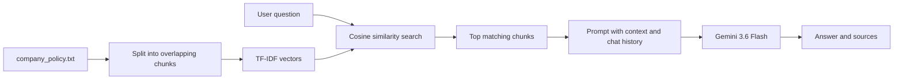

# 🏢 HR Policy RAG Assistant

An internal HR assistant that answers employee questions about leave, probation, notice period, benefits, and workplace policies, using only the company's own handbook as its source.

Instead of searching through an 80-page handbook, an employee asks a question in plain English and gets a direct answer, along with the handbook sections it came from.

---

## 💡 The Problem

In most companies, policy information is spread across long handbooks, insurance documents, and leave manuals. Employees either skip reading them or keep messaging HR with the same questions. This project puts the handbook behind a chat interface so answers are instant, consistent, and traceable to a source.

---

## ✨ Features

- **Retrieval-Augmented Generation (RAG):** Finds the most relevant parts of the handbook for each question and gives them to the LLM as context.
- **Source Citations:** Every answer shows the handbook sections it used, in an expandable "Sources" drawer.
- **Conversational Memory:** Remembers recent messages, so follow-ups like "What about during probation?" work.
- **Hallucination Guardrails:** The prompt restricts answers to the retrieved policy text. If a topic isn't covered, the assistant says so and points to HR instead of guessing.
- **Lightweight Retrieval:** Uses TF-IDF with cosine similarity from scikit-learn, so there is no vector database to install or run.
- **Clean Chat Interface:** A dark-themed Streamlit UI with clickable example questions and a small sidebar showing the handbook version, HR contact, and a clear-chat button.

---

## 🔍 How It Works



1. **Ingestion:** `ingest.py` reads the policy document and splits it into overlapping chunks.
2. **Indexing:** `vector_store.py` converts the chunks into TF-IDF vectors.
3. **Retrieval:** The user's question is converted the same way, and the closest chunks are found using cosine similarity.
4. **Generation:** `rag_pipeline.py` builds a prompt from the retrieved chunks and recent chat history, and sends it to Gemini.
5. **Response:** The answer is shown in the chat, with the source sections listed underneath.

---

## 🛠️ Tech Stack

| Area | Technology |
|---|---|
| Frontend | Streamlit |
| LLM | Google Gemini 3.6 Flash (`google-genai` SDK) |
| Retrieval | scikit-learn (`TfidfVectorizer`, cosine similarity), NumPy |
| Configuration | python-dotenv |
| Language | Python 3.10+ |

---

## 📁 Project Structure

```text
Simple-Rag-Chatbot/
│
├── app.py                  # Streamlit UI and chat flow
├── rag_pipeline.py         # Prompt building, history handling, and Gemini calls
├── vector_store.py         # TF-IDF vectorizer and cosine similarity search
├── text_splitter.py        # Recursive text chunking logic
├── ingest.py               # Reads and chunks the policy document
├── company_policy.txt      # Source HR policy document
├── requirements.txt        # Project dependencies
├── .env                    # API key (gitignored)
├── .gitignore              # Files excluded from version control
└── README.md               # Project documentation
```

---

## 🚀 Getting Started

### 1. Clone the repository
```bash
git clone https://github.com/Bsathwikreddy05/Simple-Rag-Chatbot.git
cd Simple-Rag-Chatbot
```

### 2. Create a virtual environment
```bash
python -m venv venv

# Windows
venv\Scripts\activate

# macOS / Linux
source venv/bin/activate
```

### 3. Install dependencies
```bash
pip install -r requirements.txt
```

### 4. Add your API key
Create a `.env` file in the project root:
```env
GEMINI_API_KEY=your_gemini_api_key_here
```
You can get a free key from [Google AI Studio](https://aistudio.google.com/).

### 5. Ingest the policy document
```bash
python ingest.py
```

### 6. Run the app
```bash
streamlit run app.py
```
The app opens at `http://localhost:8501`.

---

## 💬 Example Questions

- How many PTO days can I carry forward, and by when must I use them?
- I'm on probation. Can I take a week off?
- What is my notice period after confirmation?
- How do I claim OPD expenses, and what is the deadline?
- Can I take leave during my notice period?
- What's the dress code? *(not in the handbook, so the assistant should say it doesn't know)*

---

## 🧠 Design Decisions

- **TF-IDF instead of a vector database:** The handbook is small, so TF-IDF gives fast and predictable retrieval with no extra infrastructure. It also keeps the project easy to run and explain.
- **Overlapping chunks:** Overlap stops a rule from being cut in half at a chunk boundary.
- **Strict grounding prompt:** The model is told to answer only from the retrieved text, which reduces made-up answers and makes citations meaningful.
- **Sources shown with every answer:** Employees can check the original policy section instead of trusting the answer blindly.

---

## ⚠️ Limitations

- TF-IDF matches keywords, not meaning. A question worded very differently from the handbook ("time off" vs "PTO") may retrieve weaker results than semantic search would.
- The assistant covers one document. It doesn't support multiple files or access control per employee.
- The sample handbook is fictional and is not legal or HR advice.

---

## 🔮 Future Improvements

- Switch to embedding-based retrieval with a vector store such as Chroma or FAISS.
- Support multiple policy documents with a "filter by document" option.
- Add a small evaluation set of test questions to measure answer accuracy.
- Add user login and feedback buttons (helpful / not helpful) on answers.

---

## 🔒 Security & Privacy

- API keys are stored in `.env`, which is excluded from version control through `.gitignore`.
- Answers are limited to the internal policy document, and the assistant is instructed not to answer from outside knowledge.
- Never commit your `.env` file or share your API key.

---

## 📄 License

This project is for learning and portfolio purposes. Add a license of your choice (for example, MIT) before reusing it.